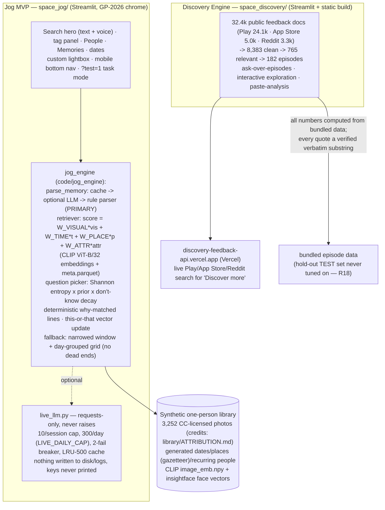

# Google Photos Retrieval Case Study — "Jog" MVP

Fellowship case study on the problem: *"Increase the percentage of Google Photos users who successfully retrieve a photo they remember but cannot precisely describe."* Ships **two public web apps** — a Google Photos-styled, AI-guided retrieval MVP (**Jog**) and a **Discovery Engine** over ~32k real public feedback documents — plus the research artifacts behind both (interview kit, test kit, pre-registered hypotheses, 10-slide deck). Everything is real, reproducible and traceable; both apps work with **zero LLM configured** — the live LLM is an optional layer.

## Live

- **Discovery Engine (static build, Hugging Face Space):** https://pm-ai-18-photo-retrieval-discovery.static.hf.space/
- **"Discover more" search API (Vercel):** https://discovery-feedback-api.vercel.app/ — live Play / App Store / Reddit search, 10 req/min/IP
- **Jog MVP (Vercel):** https://space-jog.vercel.app — ⚠️ returning 502 as of 2026-11-19; redeploy the `vercel_deploy/` staging copy (2.5 GB function-size cap on the full library is the known constraint). Full Streamlit app runs locally.

## System design



**Key decisions**

- **Rule parser is primary; LLM is optional garnish.** `parse_memory` tries cache → optional LLM → deterministic rule parser; the retriever, question picker and why-matched explanations are all deterministic. Zero-LLM mode: nothing leaves the box.
- **No dead ends, ever.** Every retrieval path ends in a narrowed window + day-grouped grid fallback, and every "why did this match" line is generated from the scoring terms.
- **Honesty by construction.** Every number in the Discovery Engine is computed from bundled data; every quote is a verified verbatim substring; a held-out TEST set is never tuned on (R18).
- **No personal data.** The library is synthetic with free-licensed images; nothing is uploaded, nothing personal is stored. Model weights + image caches live on disk only (gitignored).

## Run it

```bash
.venv/bin/pip install -r space_jog/requirements.txt
.venv/bin/streamlit run space_jog/app.py            # Jog MVP -> :8501 (?test=1 task mode)
.venv/bin/streamlit run space_discovery/app.py --server.port 8502   # Discovery Engine -> :8502
```

Both apps run with **no keys set at all**. Optional keys in `.env` (gitignored, never printed): `LLM_BASE_URL/LLM_API_KEY/LLM_MODEL` (local LLM profile), `LIVE_LLM_BASE_URL/LIVE_LLM_API_KEY/LIVE_LLM_MODEL` + `LIVE_DAILY_CAP` (hosted live layer), `PEXELS_API_KEY` (library build only), `HF_TOKEN` (HF Space deploy only).

**Deploys:** staging copies in `vercel_deploy/`, `vercel_deploy_mine/`, `vercel_discovery_api/`, `vercel_redirect/`, `vercel_deploy_tools/`; HF Spaces via `.venv/bin/python code/deploy_space.py --folder space_jog --name jog-memory-retrieval` (Jog) / `--folder space_discovery --name photo-retrieval-discovery --sync-data` (Discovery, dynamic).

## Deliverables & repo

1. **Discovery Engine** — AI-powered web app analyzing public user feedback (live on HF, static build).
2. **Jog MVP** — deployed AI-native retrieval app (Vercel; see status above).
3. **Research artifacts** — interview kit, test kit, pre-registered hypotheses (`research/`).
4. **10-slide deck** (`deck/`, notes in `deck/notes_for_deck.md`).

```
code/            jog_engine, prompts, deploy scripts (space/Vercel/Cloud Run)
space_jog/       Jog MVP app (Streamlit) + GP-2026 styling (assets/gp.css)
space_discovery/ Discovery Engine app (Streamlit + static build)
data/ research/  tables, app data, interview/test kits, test logs
library/         synthetic photo library + attributions
vercel_*/        deploy staging copies (weights/caches gitignored)
STATE.md         living status + session log · docs/ role-and-rules + locked context
```
